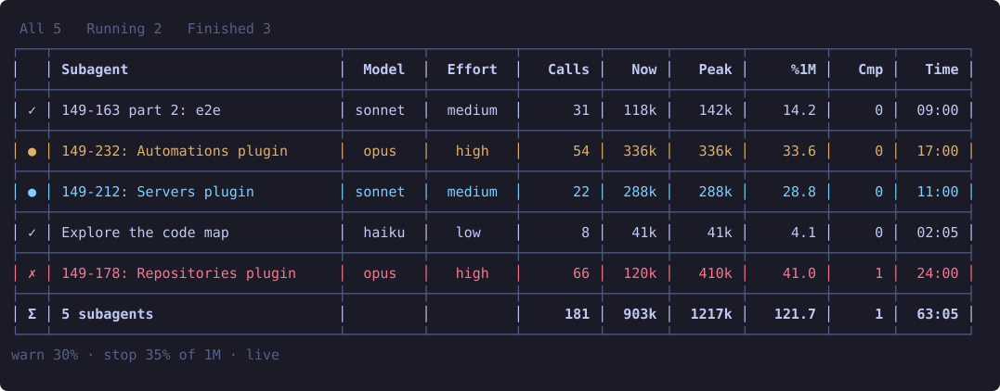

# subagent-context

The Claude Code mod `divramod-subagent-context`: a live pane of every subagent of the session with its model, effort, context fill, peak and compactions.

Imported from the mods repository by plan 0233 (its `import.sh`); published to
[divramod/agent-plugins](https://github.com/divramod/agent-plugins) as
`plugins/divramod-subagent-context` by the publish job ([claude-code-plugins](../../../../.adr/claude-code-plugins.md)).
Install it (more in that repository's README):

```
/plugin install divramod-subagent-context --marketplace divramod/agent-plugins
```



## Use

- **Open**: the `subagents` button above the prompt (its key `s` once that band has the keyboard) or
  `/divramod-subagent-context`. The pane never opens by itself: not on a session's start, on `/reload-plugins` or on
  a subagent's start (plan 0233 D6).
- **Keyboard**: the pane takes the keyboard only when you open it. While it holds it, its title line starts with
  `[pane has the keyboard - Esc returns it]` (a stable prefix hal2's typing guard reads, plan 0233 D3); Escape gives
  it back, and after a minute without a key it gives it back by itself. Every focus move is logged to
  `~/.claude/divramod-subagent-context/focus.log` (`$CLAUDE_CONFIG_DIR` if set).
- **Close**: `q` while the pane has the keyboard, the `close` button, or `ctrl+x x`.
- **Tabs**: subagents (`s`), plans (`p`), agents (`a`) and jobs (`b`); sort by a header, drag a border to resize,
  `h` / `l` switch the filter, `j` / `k` move a row.
- **Plans tab, two groups above its list** (plan 0275), each only where it has rows:
  - **The masterplan** of this session's folder: one line `<crop glyph> <number> · 2/17 plans · 19/147+ steps`, then a
    row per plan with its number, the plan, the field it runs in (`-` when none), its steps `done/total`, its status
    (`done`, `running`, `next`, `draft`, `blocked`) and its Needs. It needs hal2: the mod runs `hal2-cli-plans
    masterplan --repo <folder> --json` (3 s timeout) once per reload of the sessions, only while the pane is open and
    shows the plans tab; without the binary, an older one or a folder with no masterplan the group is absent.
  - **Servants of this field**: the sessions of this repository whose `LEAD` (`<foreman's field> <plan> <step>`)
    names this session's field, with the plan they do, the step, that step's status, the plan's `done/total`, their
    state and age. For a servant of a masterplan (the marker names the masterplan's slug and the row) the step and the
    numbers come from the same JSON, no second process, and the masterplan group shows its field in the row; any other
    marker, or no hal2, gives the marker's plan and step with the two status cells empty. The mod never reads a plan's
    step table.
- **Remembered rows**: kept in `~/.claude/divramod-subagent-context/rows-<folder>.json` (300 rows, 14 days) so a
  `/clear` keeps them.
- **Options** (`/plugin`, the mod's configuration): `window` (`auto`, `200k`, `1m`), `warn_percent` (30),
  `alert_percent` (35).

## Module map

- [.claude-plugin/plugin.json](.claude-plugin/plugin.json): the manifest, its `version` and `userConfig` options.
- [hooks/hooks.json](hooks/hooks.json): the hooks module, `register.tsx`.
- `hooks/`, the mod's source; each `*.test.ts(x)` beside the file it tests, run by `claude plugin test`:
  - [register.tsx](hooks/register.tsx): registers the pane, the command, the button and the hooks; does the IO.
  - [keyboard.ts](hooks/keyboard.ts): the keyboard rules (never opens or takes the keyboard by itself, marker, idle
    release), pure.
  - [pane-view.tsx](hooks/pane-view.tsx), [table-view.tsx](hooks/table-view.tsx): the pane and its table.
  - [grid.ts](hooks/grid.ts), [table.ts](hooks/table.ts), [tabs.ts](hooks/tabs.ts): columns, widths, sort, filter
    and the four tabs.
  - [rows.ts](hooks/rows.ts), [transcript.ts](hooks/transcript.ts), [backfill.ts](hooks/backfill.ts): a subagent's
    row from its steps and its transcript.
  - [sessions.ts](hooks/sessions.ts), [jobs.ts](hooks/jobs.ts): the plans, agents and jobs tabs' rows.
  - [live.ts](hooks/live.ts) (its test [live.test.ts](hooks/live.test.ts)): the session check behind the plans and
    agents tabs: one `kill -0` per pid, one refresh at a time, every 30 s and only while the pane shows one of the two;
    each session's row with its `CURRENT_PLAN` and `LEAD` (the git dir's `hal/`, else `plans/`).
  - [load.ts](hooks/load.ts) (its test [load.test.ts](hooks/load.test.ts)): what follows each refresh inside its turn,
    through closures over `$` that register.tsx hands it: this session's folder and, only on an open plans tab, the
    masterplan's one process; [masterplan.ts](hooks/masterplan.ts): the roll-up's parse and the two groups' rows, pure.
  - [store.ts](hooks/store.ts): the remembered rows.
  - [testkit.ts](hooks/testkit.ts): what the tests share.
- [types/index.d.ts](types/index.d.ts): the mod's own types; [tsconfig.json](tsconfig.json) extends the engine's
  types, which `claude` writes to the ignored `.claude-plugin/types/`.
- [scripts/screenshot.ts](scripts/screenshot.ts): draws [docs/screenshot.svg](docs/screenshot.svg) from fixture rows
  through `hooks/table.ts`.

## Develop

From this folder:

```
claude plugin validate --strict .
claude plugin test .
bun scripts/screenshot.ts   # regenerates docs/screenshot.svg
```

The plugin's version is bumped by the landing, never by hand
([claude-code-plugins](../../../../.adr/claude-code-plugins.md)).
